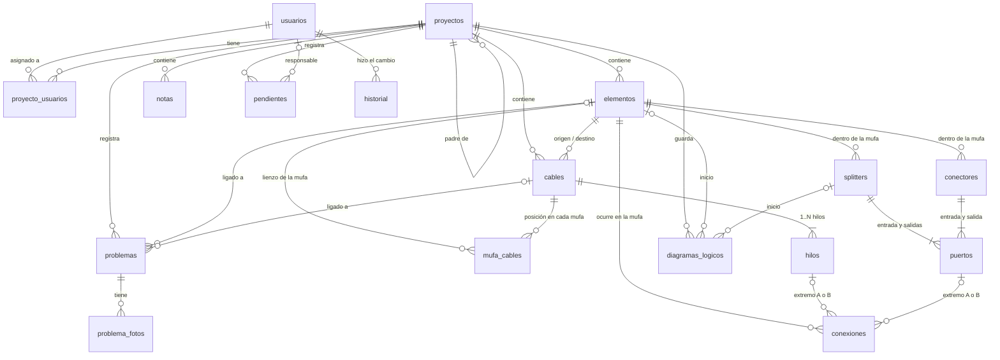
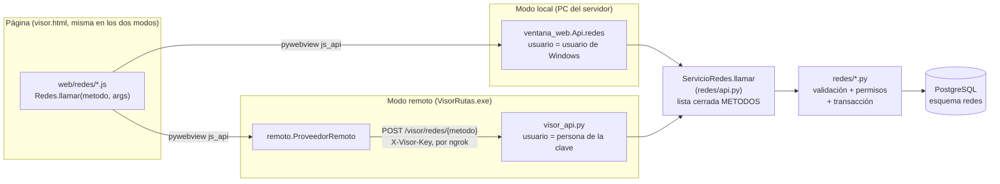

# Módulo de redes FTTH: datos y arquitectura

Cómo está construido el módulo de redes del Visor de rutas: base de datos, código, permisos y
respaldos. Responde la sección 8 de [ESPECIFICACION.md](ESPECIFICACION.md). El uso de cada pantalla
está en el `README.md` del proyecto.

Estado al 2026-10-13: fases 1 a 7 hechas, migraciones `001` a `009`. La 009 prepara la migración de
la red existente de los Visio ([../migracion_visio/PLAN.md](../migracion_visio/PLAN.md)).

---

## 1. Dónde vive

| Pieza | Valor |
|---|---|
| Base | `Presupuesto_visio` (`VISIO_DB_*` del `.env`), la misma servidora de la red Visio |
| Esquema | `redes`: todo el módulo está aquí |
| PostGIS | 3.6.2, instalado **dentro** del esquema `redes`, así `public` no se toca |
| Conexión | `search_path=redes,public`, `autocommit` con transacciones explícitas, `statement_timeout` de 30 s |
| Tablas que no se tocan | `red_lineas`, `red_puntos` y el esquema `red_fibra`: solo lectura, con otra conexión (`red_fibra_pg`). Una prueba (`test_schema_architecture_rules`) falla si una migración los nombra. |

Geometrías en EPSG:4326 (lat/lon WGS84): puntos para elementos, proyectos, notas y problemas;
`LineString` para cables; `Polygon` para el área del proyecto.

---

## 2. Modelo de datos

### 2.1 Diagrama entidad-relación

### 2.2 Diccionario de datos

Las columnas comunes se describen una vez en la §3: `id`, `version`, `creado_en`, `creado_por`,
`actualizado_en`, `actualizado_por` y `borrado_en`. Un `*` marca las obligatorias.

| Tabla | Para qué | Columnas propias | Reglas |
|---|---|---|---|
| `usuarios` | Quién usa el módulo | `nombre*`, `correo`, `rol*` (administrador / editor / lector), `persona_visor` (la de la X-Visor-Key), `usuario_windows` | correo, persona y usuario de Windows únicos (sin mayúsculas); siempre queda un administrador activo |
| `proyectos` | Proyecto de red | `codigo*`, `nombre*`, `descripcion`, `padre_id` (jerarquía), `ubicacion` (punto), `area` (polígono), `imagen` / `imagen_tipo` / `miniatura` (≤ 2 MB, sin SVG) | código único entre los activos; sin ciclos de padres |
| `proyecto_usuarios` | Quién tiene acceso a cada proyecto | `proyecto_id*`, `usuario_id*`, `asignado_en`, `asignado_por` | clave (proyecto, usuario) |
| `elementos` | Lo que se pone en el mapa | `tipo*` (poste / mufa / cliente / nodo), `subtipo` (mufa: empalme = SC, distribucion = FDT, terminal = FAT; poste: concreto / ideay / madera / metal / cliente), `nombre*`, `codigo` (cliente C#####), `ubicacion*`, `propiedades` (jsonb: capacidad, bandejas, id_servicio…), `ref_externa` | código de cliente único en el proyecto |
| `cables` | Tramo de fibra entre dos elementos | `nombre*`, `descripcion`, `clase*` (troncal / distribucion / acometida), `tipo*` (ADSS / FLAT), `hilos*` (12–144), `hilos_por_buffer*` (8 o 12), `color*`, `origen_id*`, `destino_id*`, `vertices*` (jsonb con anclas a elementos), `geom*`, `cruces*`, `longitud_m*`, `metraje` (jsonb con el detalle) | el metraje se calcula al guardar con `business_rules.yaml` → `diseno_red` |
| `hilos` | Cada hilo de un cable | `cable_id*`, `numero*` (1..hilos), `buffer*`, `color*`, `color_buffer*` (TIA-598, los pone la base), `estado*` (activo / oscura / baja / reservado / danado), `observacion` | (cable, número) único entre los activos; no se puede quitar un hilo conectado |
| `mufa_cables` | Dónde se dibuja cada cable en el lienzo de cada mufa | `mufa_id*`, `cable_id*`, `x*`, `y*`, `version*` | clave (mufa, cable); bloqueo optimista |
| `splitters` | Splitter dentro de una mufa | `mufa_id*`, `nombre*`, `salidas*` (2 / 4 / 8 / 16 / 32), `relacion` (70/30… solo 1x2, suma 100), `conector` (RC, APC…), `x*`, `y*` | no se reduce si hay salidas conectadas por encima |
| `conectores` | Conector o adaptador dentro de una mufa | `mufa_id*`, `nombre*`, `tipo` (SC/APC…), `x*`, `y*` | |
| `puertos` | Entradas y salidas numeradas de splitters y conectores | `splitter_id` o `conector_id`, `lado*` (entrada / salida), `numero*` | uno de los dos dueños; (dueño, lado, número) único |
| `conexiones` | Fusión o conexión dentro de una mufa | `mufa_id*`, `a_hilo_id` o `a_puerto_id`, `b_hilo_id` o `b_puerto_id` | cada extremo es un hilo o un puerto; un puerto con una sola conexión activa (índice único); un hilo, una por mufa; la fusión une cables distintos; el hilo debe ser de un cable que llega o sale de esa mufa |
| `notas` | Texto con formato | `contexto*` (mapa / mufa), `mufa_id`, `elemento_id` (ancla), `ubicacion` o `x`/`y`, `html*` (saneado), `ancho*` | |
| `diagramas_logicos` | Diagramas guardados (cómo generarlos, no el dibujo) | `titulo*`, `elemento_id` o `splitter_id` (inicio), `direccion*` (derecha / izquierda), `incluir_clientes*` | uno de los dos inicios |
| `problemas` | Problema en un elemento o cable | `elemento_id` o `cable_id`, `titulo*`, `descripcion`, `severidad*` (baja / media / alta / critica), `estado*` (abierto / en_proceso / cerrado), `ubicacion` (al guardar), `cerrado_en` | uno de los dos vínculos |
| `problema_fotos` | Fotos de un problema | `problema_id*`, `imagen*`, `imagen_tipo*`, `miniatura*`, `creado_en`, `creado_por`, `borrado_en` | hasta 6 activas por problema; se versionan con su problema |
| `pendientes` | Tareas | `elemento_id` o `cable_id` (opcionales), `titulo*`, `descripcion`, `responsable_id`, `fecha_limite`, `estado*` (pendiente / en_proceso / hecho), `hecho_en` | a lo sumo uno de los dos vínculos |
| `mufa_modelos` (009) | Modelo de cada mufa | `mufa_id*`, `formato*` (domo / horizontal / desconocido), `capacidad*` (48 \| 96), `empalmes_por_bandeja*` (24), `bandejas*` (2 \| 4), `modelo_estimado*`, `fuente` | uno activo por mufa |
| `mufa_bandejas` (009) | Bandejas de una mufa | `mufa_id*`, `numero*`, `capacidad*` (24, o salidas + entrada del splitter que lleva), `splitter_id`, `fuente` | (mufa, número) único; un splitter en una sola bandeja |
| `puerto_servicios` (009) | Cliente de una salida de splitter, aunque no esté en el mapa | `puerto_id*`, `codigo_cliente`, `nombre`, `id_servicio`, `elemento_id`, `fuente`, `confianza` | un cliente por puerto |
| `mufa_clientes` (009) | Clientes listados en una mufa sin puerto conocido | `mufa_id*`, `codigo_cliente`, `nombre`, `id_servicio`, `elemento_id`, `fuente`, `confianza` | |
| `migracion_visio_corridas`, `migracion_visio_log` (009) | Cada corrida de la migración de los Visio y su detalle | modo (simular / real), zona, respaldo previo, conteos; entidad, clave, acción, avisos | solo se insertan |
| `historial` | Auditoría de todo cambio | `fecha*`, `usuario_id`, `proyecto_id`, `entidad*`, `entidad_id`, `accion*` (crear / editar / eliminar / restaurar / duplicar / identificar), `cambio` (jsonb `{campo: [antes, después]}`) | solo se inserta |
| `migraciones` | Scripts aplicados | `version*`, `nombre*`, `checksum*`, `aplicada_en*` | |

**Columnas de la red existente (009)** en tablas que ya existían:

| Tabla | Columnas nuevas |
|---|---|
| `proyectos` | `es_red_base`, `zona` |
| `elementos` | tipo `odf`; subtipos `mini_nodo` y `reserva`; `ubicacion` opcional solo si `ubicacion_fuente = sin_ubicar` (`real` / `estimada` / `sin_ubicar` / `usuario`); `fuente`, `confianza`, `estado_migracion`, `ref_visio` (clave única por proyecto) |
| `cables` | `hilos` opcional (desconocido) y 2…144; `hilos_por_buffer` 2, 4, 6, 8, 12; calculadas `buffers` y `configuracion` ("6x4"); `configuracion_estimada`, `tipo_fibra` ("SM dispersión cero"), `fuente`, `confianza`, `geom_fuente` (kmz / recta / usuario), `estado_migracion`, `ref_visio` |
| `splitters` | `propiedades` (OLT, puerto OLT, depende de), `fuente`, `confianza` |
| `conexiones` | `bandeja`, `posicion_en_bandeja` (1–24, única por mufa), `fuente`, `confianza` |

- **Valores admitidos:** dominios `redes.fuente_dato` (usuario, excel_anillos, texto_diagrama, geometria_visio, kmz, kayako, estimado), `redes.confianza_dato` (verificada, alta, media, baja) y `redes.estado_migracion` (automatica, en_revision, validada, editada).
- **Lo que el usuario edita manda:** `red.guardar` marca `editada` un elemento o cable migrado que alguien cambia.
  - Una mufa sin ubicar, o con ubicación estimada, que alguien coloca pasa a ubicación `usuario`.
  - Cambiar hilos o buffers quita `configuracion_estimada`; redibujar el trazo lo pasa a `usuario`.

**Calculados, no guardados:**
- **colores en la pantalla:** el editor de mufa los vuelve a calcular con la misma fórmula que la base;
- **lo que hay en el otro extremo de cada hilo:** se consulta al leer la mufa;
- **el dibujo del diagrama lógico:** se genera de las conexiones;
- **el trazado de un hilo.**

### 2.4 Mis lugares (migración 011, visor v2)

Lo personal de cada usuario, aparte de proyectos y red: no se toca ninguna tabla anterior.

| Tabla | Qué guarda |
|---|---|
| `lugares_carpetas` | Árbol por usuario (`padre_id`), `orden` manual, `visible`, `expandida` (hoy lo abierto se recuerda en el equipo, no aquí) |
| `lugares_elementos` | `tipo` (marca, ruta, poligono y, para la fase 4, mufa, poste, cliente, nodo, odf, cable; la geometría debe ser de su clase), `geom`, `descripcion_html`, `estilo`, `vista` (centro y zoom), `propiedades` (en un cable: clase, hilos…), `orden`, `visible` |
| `lugares_adjuntos` | Imágenes de la descripción (PNG / JPEG / WEBP / GIF, hasta 2 MB), en la base |
| `lugares_compartidas` | Con quién se comparte una carpeta (y sus subcarpetas) y si puede editar |

- **Dueño:** lo creado dentro de una carpeta compartida es del dueño de la carpeta (`usuario_id` de la carpeta). El acceso se calcula subiendo por las carpetas madre.
- **Descripción:** HTML seguro (`texto.py`); sus imágenes se guardan aparte y la descripción las nombra ``.

### 2.3 Reglas que cuidan triggers en la base

| Trigger | Qué hace |
|---|---|
| `hilos_buffer_color` (antes de insertar o cambiar un hilo) | `buffer = (numero−1) / hilos_por_buffer + 1`; `color = TIA[(numero−1) % hilos_por_buffer]`; `color_buffer = TIA[(buffer−1) % 12]` |
| `cables_recolorear_hilos` (después de cambiar `hilos_por_buffer`) | Recalcula los hilos de ese cable |

Función `redes.color_tia(i)`: 0 azul, 1 naranja, 2 verde, 3 café, 4 gris, 5 blanco, 6 rojo, 7 negro, 8 amarillo, 9 violeta, 10 rosa, 11 aqua.

---

## 3. Reglas transversales

- **Versión por registro (bloqueo optimista):**
  - toda tabla editable tiene `version`. Quien guarda envía la versión que leyó; si no coincide, nada se guarda y el visor ofrece recargar (`ConflictoVersion`);
  - también la posición de un cable en el lienzo de una mufa (`mufa_cables.version`, migración 008);
  - excepciones con su razón: `historial` y `migraciones` (solo se insertan); `proyecto_usuarios`, `problema_fotos` y `puertos` (se guardan junto con su proyecto, problema o splitter, que sí llevan versión).
- **Borrado lógico** (`borrado_en`): nada se borra de verdad. Los índices únicos son parciales (`WHERE borrado_en IS NULL`), así lo eliminado no bloquea códigos ni puertos.
- **Historial:** cada creación, edición, eliminación o restauración queda con usuario, fecha, entidad y diferencias, en la misma transacción que el cambio (`repositorio.registrar`).
- **Una transacción por guardado:** el editor de mapa, el de mufa y las demás ventanas mandan todos sus cambios juntos. Los ids temporales (`"n3"`) se cambian por los reales dentro de la transacción.
- **Lista blanca de columnas:** `repositorio.COLUMNAS` dice qué columnas puede escribir el código de cada tabla. Nada que venga de la página se interpola en el SQL.
- **Migraciones:**
  - `visor_rutas/redes/migraciones/NNN_nombre.sql` se aplican solas la primera vez que se usa la base (visor local o `/visor/redes/*`), solo las que faltan;
  - un *advisory lock* evita que dos procesos las apliquen a la vez, y se guarda el checksum de cada una;
  - a mano: `.\.venv\Scripts\python.exe -m visor_rutas.redes.migrar`.

| Migración | Contenido |
|---|---|
| 001 | usuarios, proyectos, proyecto_usuarios, historial |
| 002 | miniatura del proyecto, índice por nombre |
| 003 | elementos |
| 004 | cables, notas |
| 005 | hilos, mufa_cables, splitters, conectores, puertos, conexiones |
| 006 | diagramas_logicos |
| 007 | problemas, problema_fotos, pendientes |
| 008 | buffer y color en `hilos` (triggers), versión en `mufa_cables`, índices |
| 009 | red existente (Visio): proyectos base, origen y confianza, cables con hilos desconocidos y buffers de 2 a 12, `odf`, elementos sin ubicar, bandeja y posición del empalme, `mufa_modelos`, `mufa_bandejas`, `puerto_servicios`, `mufa_clientes`, registro de corridas. Lleva `-- respaldo: previo` |

Una migración que empieza con `-- respaldo: previo` hace antes un **respaldo completo automático** (`respaldo.respaldar`), si la base tiene proyectos. Si el respaldo falla, la migración no se aplica. El respaldo exporta solo las columnas y tablas que existen en ese momento, porque corre con el esquema anterior.

---

## 4. Arquitectura del código

### 4.1 Cómo viaja una llamada

- **Un solo punto de entrada:** `ServicioRedes.llamar(metodo, args)` (`redes/api.py`). Solo se pueden llamar los métodos de la lista `METODOS`.
  - Identifica al usuario (`usuarios.identificar`) y aplica las migraciones que falten.
  - Convierte los errores en `{ok: false, error, errores?, conflicto?}`.
- **El usuario nunca lo manda la página:** en local sale de Windows (`getpass`); en remoto, de la clave.
- **Límite por hora en remoto:** solo cuentan los métodos que llaman a Google (`CON_LIMITE = {"geocodificar"}`).
- **El `.exe` remoto** lleva solo las páginas; el backend del módulo (`visor_rutas.redes`) corre en el servidor. `herramientas/empaquetar_visor.py` lo verifica.

### 4.2 Backend: `visor_rutas/redes/`

| Módulo | Responsabilidad | Métodos de `METODOS` |
|---|---|---|
| `db.py` | Conexión y errores para el usuario | — |
| `migrar.py` | Migraciones | — |
| `repositorio.py` | Insertar y actualizar con versión, historial, lista blanca de columnas | — |
| `usuarios.py` | Identificación, roles, alta, desactivar | `estado`, `usuarios`, `guardar_usuario`, `estado_usuario`, `historial_usuario` |
| `proyectos.py` | Proyectos, jerarquía, imagen, área, clientes, geocodificación | `proyectos`, `proyecto`, `guardar_proyecto`, `duplicar_proyecto`, `eliminar_proyecto`, `restaurar_proyecto`, `historial_proyecto`, `usuarios_asignables`, `geocodificar` |
| `elementos.py` | Clientes del proyecto | — |
| `red.py` | Red del editor de mapa: elementos, cables, notas; copia al duplicar | `red_proyecto`, `guardar_red` |
| `metraje.py` | Metraje de un cable (`business_rules.yaml` → `diseno_red`) | — |
| `texto.py` | HTML seguro de las notas | — |
| `mufa.py` | Editor de mufa: hilos, splitters, conectores, conexiones, posiciones | `mufa`, `guardar_mufa` |
| `bandejas.py` | Modelo de la mufa (48 / 96) y bandejas de 24 posiciones, con su motivo cuando es estimado | `guardar_modelo_mufa`, `mover_empalme`, `bandeja_splitter` |
| `mufas_existentes.py` | La red existente interactiva: encontrar la mufa migrada de lo que se abre en el mapa, validar, configuración del cable, red de mufas vecinas y **búsqueda por nombre o código** para el buscador del mapa (visor v2: lo creado en la herramienta y los clientes) | `mufa_existente`, `validar_mufa`, `configurar_cable`, `red_de_mufas`, `buscar_elementos` |
| `migracion_tablero.py` | Tablero de avance y cola de corrección de la red migrada (solo lee), exportable a Excel | `tablero_migracion`, `correcciones_migracion`, `exportar_correcciones` || `lugares.py` | Mis lugares: árbol, carpetas, marcas / rutas / polígonos, orden y mover, casillas, compartir, imágenes de la descripción | `lugares`, `lugar`, `guardar_lugar`, `eliminar_lugar`, `adjunto_lugar`, `guardar_carpeta_lugares`, `eliminar_carpeta_lugares`, `mover_lugares`, `visibilidad_lugares`, `compartidos_lugares`, `compartir_lugares` |
| `lugares_kmz.py` | Exportar una carpeta a KMZ e importar KMZ / KML (todo o nada; lee KML 2.0 / 2.1 / 2.2) | `exportar_lugares_kmz`, `importar_lugares_kmz` |
| `lugares_iconos.py` | Catálogo de íconos propios y su dibujo en PNG para el KMZ | — |
| `trazado.py` | Trazado de un hilo de punta a punta | `trazar_hilo` |
| `diagrama.py` | Diagrama lógico | `diagramas`, `guardar_diagrama`, `eliminar_diagrama`, `generar_diagrama` |
| `problemas.py` | Problemas con fotos; referencias de un proyecto | `problemas`, `problema`, `foto_problema`, `guardar_problema`, `eliminar_problema`, `historial_problema`, `referencias_proyecto` |
| `pendientes.py` | Pendientes | `pendientes`, `guardar_pendiente`, `eliminar_pendiente`, `historial_pendiente` |
| `respaldo.py` | Respaldo JSON + `pg_dump`, restaurar como copia, exportar KMZ / GeoJSON | `respaldos`, `crear_respaldo`, `restaurar_respaldo`, `descargar_respaldo`, `exportar_proyecto` |
| `verificar.py` | Integridad de los datos (12 reglas, solo lee) | `verificar_base` |
| `migrar_visio.py` | Migración de la red existente (`red_fibra` + KMZ, solo lectura) a los proyectos base: `--simular`, `--zona`, `--solo-mufas`, reporte Excel, respaldo previo, idempotente por la clave Visio; mueve de región lo ya migrado si cambian las reglas (no lo editado) | — (línea de comandos) |
| `migrar_visio_contenido.py` | Fase 3 de la migración: splitters (`propiedades`: olt, puerto_olt, potencia_dbm, depende_de, clave_visio), `puerto_servicios`, `mufa_clientes`, clientes en el mapa (KMZ) y empalmes del Excel de anillos (`conexiones.fuente = excel_anillos`) | — (lo llama `migrar_visio.py`) |
| `api.py` | `ServicioRedes` y la lista `METODOS` | — |

Además, `ventana_web.Api` guarda en la PC de quien usa el visor lo que el módulo produce. Usa el diálogo de Windows y funciona también en el `.exe`:
- `guardar_imagen`: PNG o PDF del diagrama;
- `guardar_archivo`: KMZ, GeoJSON y respaldos `.json` o `.sql`.

### 4.3 Página: `visor_rutas/web/`

| Archivo | Qué es |
|---|---|
| `menu.js` | Menú lateral con íconos, contraíble |
| `redes/comun.js` | `Redes.llamar`, confirmaciones, historial, utilidades compartidas |
| `redes/usuarios.js`, `redes/proyectos.js` | Vistas Usuarios y Proyectos |
| `redes/editor_mapa.js` | Editor de red sobre el mapa (Leaflet + Geoman): paleta, cables, metraje, notas, íconos de problemas |
| `redes/editor_mufa.js` | Editor de mufa (Konva) |
| `redes/trazado.js` | Panel de trazado de hilo |
| `redes/diagrama.js` | Diagrama lógico (Konva), exportación |
| `redes/problemas.js`, `redes/pendientes.js`, `redes/respaldos.js` | Vistas Problemas, Pendientes y Backup |
| `lugares/iconos.js`, `lugares/dialogo.js`, `lugares/mis_lugares.js` | Mis lugares: íconos y su selector; ventana flotante de una marca / ruta / polígono (Quill); árbol, capas del mapa, menús, arrastrar y soltar, importar / exportar, compartir |
| `mapa/coordenadas.js`, `mapa/buscador.js`, `mapa/pin.js`, `mapa/capas_visor.js`, `mapa/barra_herramientas.js` | Visor v2: lector de coordenadas, buscador con varias fuentes, pincho de una coordenada, capas del visor en el árbol de Lugares y barra de herramientas |

**Librerías:** todas locales en `web/lib/`, sin CDN, cada una con su licencia al lado.

| Librería | Versión | Licencia | Uso |
|---|---|---|---|
| Leaflet | 1.9.4 | BSD-2 | Mapa |
| Leaflet.markercluster | 1.5.3 | MIT | Agrupar puntos |
| Leaflet.PolylineDecorator | — | MIT | Flechas en rutas |
| Leaflet-Geoman free | 2.17.0 | MIT | Dibujar y editar el área |
| Konva | 9.3.18 | MIT | Editor de mufa y diagrama lógico |
| Quill | 2.0.3 | BSD-3 | Texto con formato |

---

## 5. Permisos

| Acción | Administrador | Editor asignado | Lector asignado | Sin asignar |
|---|---|---|---|---|
| Ver un proyecto, su red, mufas, diagramas, trazado | sí | sí | sí | no |
| Crear proyectos | sí | sí (queda asignado) | no | no |
| Editar red, mufas, diagramas, datos del proyecto | sí | sí | no | no |
| Reportar un problema | sí | sí | **sí** | no |
| Cambiar o cerrar un problema | sí | sí | solo los que él reportó | no |
| Crear o editar pendientes | sí | sí | no (el **responsable** cambia el estado) | no |
| Exportar KMZ / GeoJSON | sí | sí | sí | no |
| Usuarios, respaldos, restaurar, verificar la base | sí | no | no | no |

Un usuario remoto (X-Visor-Key) entra como **lector** y nunca se vuelve administrador solo.

**Proyectos base** (`proyectos.es_red_base`, la red existente migrada de los Visio): para ellos "asignado" no hace falta. Todos los ven (lista de proyectos, Problemas) y todo editor los edita; los lectores siguen sin editar. Un cable migrado entre dos regiones queda en el proyecto de su origen y conserva su otro extremo en el proyecto base vecino mientras ese extremo no se cambie (`red._extremos_otra_region`).

---

## 6. Respaldo, restauración e integridad

- **Crear respaldo** (`respaldo.crear`) escribe en `respaldos_redes\` o en `REDES_RESPALDOS_DIR`:
  - `respaldo_redes_AAAA-MM-DD_HHMMSS.json`: todos los proyectos activos con todo su contenido, leídos en **una** transacción `REPEATABLE READ`, así es una foto coherente;
  - `….sql`: `pg_dump -n redes` (de `C:\Program Files\PostgreSQL\*\bin`, del PATH o de `REDES_PG_DUMP`). Para recuperar la base entera con `psql`.
- **Restaurar** (`respaldo.restaurar`) importa **un** proyecto del `.json` como proyecto **nuevo** (`-R1`, `-R2`…):
  - todos los ids se vuelven a mapear;
  - los usuarios se emparejan por persona del visor, usuario de Windows o nombre;
  - nunca pisa el proyecto actual.
- **Verificar la base** (`verificar.revisar`) revisa 12 reglas que cruzan tablas y solo lee:

  | Nivel | Reglas |
  |---|---|
  | Errores | hilos del cable completos; buffer y color correctos; cables sin extremos eliminados; conexiones con hilos existentes, de cables que llegan a esa mufa y con puertos válidos de esa mufa; un hilo conectado una vez por mufa; salidas de splitter dentro de su tamaño |
  | Avisos | vértices pegados a elementos eliminados; diagramas sin inicio; problemas abiertos sobre algo eliminado; pendientes con responsable desactivado |

  Desde el menú Backup, o `python -m visor_rutas.redes.verificar`.
- **`respaldos_redes\` es sensible** (datos y fotos): no se publica, igual que `output\`. Tampoco va dentro del `.exe`, y `herramientas/empaquetar_visor.py` lo verifica.

---

## 7. Pruebas

- `Pruebas/test_redes_*.py` usan una base temporal `redes_pruebas_<pid>_<azar>`, que se crea y se borra en cada corrida. El código se niega a borrar una base que no empiece por `redes_pruebas`.
- Cubren repositorio, validaciones, trazado, diagrama lógico, permisos, respaldo y restauración, exportación, y **reglas de arquitectura** (`test_redes_seccion8.py`):
  - todo en el esquema `redes`;
  - toda tabla editable con versión y borrado lógico;
  - ninguna migración nombra las tablas existentes;
  - la lista blanca de columnas apunta a tablas reales.
- `POST /presupuesto` y n8n no dependen del módulo, y sus pruebas siguen en la misma suite.

---

## 8. Cómo agregar algo

1. **Tabla o columna:** una migración nueva `NNN_nombre.sql`. Nunca se edita una ya aplicada, porque cambia su checksum. Incluir `version` y `borrado_en` si se edita registro por registro, índices parciales `WHERE borrado_en IS NULL`, y la tabla en `repositorio.COLUMNAS`.
2. **Operación:** una función `f(con, actor, *, …)` en su módulo que revise permisos (`proyectos.puede_ver` / `puede_editar`), escriba dentro de `with con.transaction()` y registre el historial. Luego se agrega a `METODOS` en `api.py`. Si llama a Google, también a `CON_LIMITE`.
3. **Página:** `Redes.llamar("metodo", {...})`. Si es un archivo nuevo, se agrega a `visor.html` y a la lista de páginas obligatorias de `herramientas/empaquetar_visor.py`.
4. **Pruebas** en `Pruebas/test_redes_*.py`, con los fixtures de `redes_base.py`.

---

## 9. Diferencias con la especificación (decididas)

| Especificación | Cómo quedó | Por qué |
|---|---|---|
| `hilos` con "buffer, color TIA" | Guardados en `hilos`, los calcula la base con un trigger (migración 008) | Nunca pueden quedar distintos de `hilos_por_buffer` |
| `splitters` con "tipo" | `salidas` (2…32) + `relacion` (70/30) + `conector` (RC…) | Es el tipo descompuesto, validable |
| Respaldo `.sql` o JSON | Siempre `.json` + `.sql` si hay `pg_dump` | Solo el JSON permite "restaurar como copia nueva de proyecto" |
| Carpeta de respaldo configurable | `REDES_RESPALDOS_DIR` en el `.env` del servidor | Que una clave remota no pueda escribir en rutas arbitrarias |
| Diagrama lógico guardado | Se guarda cómo generarlo, no el dibujo | Siempre refleja las conexiones actuales |
| `elementos` con "FAT/FDT" como tipo | `tipo = mufa` + `subtipo` (empalme / distribucion / terminal) | Una mufa cambia de función sin cambiar de tabla ni de editor |
